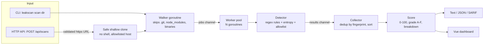

# leakscan

**A small, fast secret scanner for source code, written in Go with a Vue 3 dashboard.**

leakscan finds hardcoded credentials (cloud keys, Git tokens, private keys, passwords) before they reach the main branch. It runs as a **CLI** (CI gate or pre-commit hook) or as a **web service** that clones a repository and shows an explainable security score. Results can be exported as **SARIF 2.1.0**, the format GitLab, GitHub and DefectDojo ingest.

> I built this as a learning project to get hands-on with **Go** and **Vue 3** in the application-security domain (continuous code scanning, signal quality and scoring). It was built with AI assistance, and I reviewed, tested and can explain every part of it. Design notes are below, and limitations are listed honestly at the end.

---

## Quick start

```bash
# CLI: scan a directory (exit code 0 = clean, 1 = findings, 2 = scan error)
go run ./cmd/leakscan scan .
go run ./cmd/leakscan scan --format sarif --fail-on high ./some/repo > results.sarif

# Web UI + API (build the frontend once, it is embedded into the binary)
cd web && npm ci && npm run build && cd ..
go run ./cmd/leakscan serve --addr :8080 --allow-hosts github.com,gitlab.com
# open http://localhost:8080 and click "Scan demo project"

# Docker
docker build -t leakscan .
docker run --rm -p 8080:8080 leakscan
```

## Deploy for free (Render)

The repository contains a `render.yaml` blueprint: a free Docker web service, health-checked on `/api/health`.

1. Push the repository to GitHub.
2. On [render.com](https://render.com), sign in with GitHub → **New** → **Blueprint** → select the repository → **Apply**.
3. Wait for the first build (~3–5 min). The app is served at `https://leakscan-xxxx.onrender.com`.

The free tier sleeps after 15 minutes without traffic. The first request after that takes about a minute to wake it up.

## Architecture



| Package | Responsibility |
|---|---|
| `cmd/leakscan` | CLI entry point, exit codes, graceful shutdown of the server |
| `internal/detect` | Rules, entropy, placeholder allowlist, masking, fingerprinting |
| `internal/scan` | Directory walk + bounded worker pool + deduplication |
| `internal/score` | Explainable score with per-severity breakdown and a hard cap |
| `internal/report` | Text, JSON and SARIF 2.1.0 output |
| `internal/gitsrc` | URL validation and safe `git clone` |
| `internal/api` | HTTP handlers, security headers, concurrency limit |
| `internal/demo` | Generated fake repository for tests and the demo button |
| `web/` | Vue 3 + TypeScript dashboard (Composition API, no UI library) |

## Design decisions

**Signal quality over volume.** A scanner that cries wolf gets ignored or bypassed. Specific rules (AWS, GitHub, GitLab, Slack, private keys, JWT) are high-confidence. The generic `password = "..."` rule is gated by **Shannon entropy**, and known placeholders (`changeme`, `example`, `${VAR}`) are ignored. A reviewed line can be suppressed explicitly with an inline `leakscan:ignore` comment, which stays visible in code review.

**The secret is never stored.** Findings carry a masked value (`ghp_********`) and a fingerprint. The raw secret is never logged, printed or returned by the API; tests assert this.

**Fingerprints without line numbers.** `fingerprint = sha256(rule, file, sha256(secret))`. When code above the secret moves, the fingerprint stays the same, so deduplication and triage decisions survive.

**Fail closed.** A file that can't be read makes the scan *incomplete* and returns exit code 2. A cancelled or failed scan returns an error. A scan failure must never look like "0 findings, all clean".

**Untrusted input everywhere.** The scanned repository and the requested URL are attacker-controlled:
- URLs must be `https`, on an allowlisted host, without credentials, ports or query strings. This blocks SSRF and dangerous git transports (`file://`, `ext::`).
- `git` is called with separate arguments and `--`, **never through a shell**, plus `protocol.allow=never` except https, and `GIT_TERMINAL_PROMPT=0`.
- Every scan gets its own temporary directory, removed afterwards. Symlinks are not followed.
- The request body is size-limited, error details stay in the logs, and concurrent scans are capped (429 instead of overload).
- The UI renders everything with escaped interpolation. `v-html` is never used, because file names and contents come from the scanned repository.

**Bounded concurrency.** One producer walks the tree, N workers scan files, and one collector owns the results (no shared mutable state, no mutex needed). Only the sender closes each channel, and `context.Context` cancels the whole pipeline.

**Explainable score.** `score = 100 - Σ(count × weight)`, where critical=25, high=10, medium=4, low=1. Any critical caps the grade at D. Every lost point is listed in the breakdown, so owners can see exactly why their score dropped.

## How this would grow into a platform

| This project | Production scanning platform |
|---|---|
| CLI / one HTTP request per scan | GitLab webhooks → API → **RabbitMQ** job per scanner type |
| In-process worker pool | Stateless Go workers in containers, autoscaled on queue depth |
| One rule-based detector | Many scanners (SAST, SCA, secrets, IaC) behind one `Scanner` interface, all normalized to SARIF |
| Fingerprint dedup in memory | `INSERT … ON CONFLICT (repo, fingerprint)` in **PostgreSQL**; fixed/reopened lifecycle |
| Simple severity score | Score with exploitability (EPSS/KEV), asset criticality and age vs SLA; history and trends |
| No auth | SSO/OIDC, owners only see their systems, audit log for triage |

## Testing

```bash
go test -race -cover ./...                                       # unit + integration tests
go test ./internal/detect -run '^$' -fuzz FuzzScanLine -fuzztime 30s   # fuzzing
go run ./cmd/leakscan scan --fail-on low .                       # dogfooding: the repo scans itself clean
```
Test fixtures are **generated at runtime** (`internal/demo`), so the repository contains no secret-looking literals and passes its own scan and push protection.

## Limitations / next steps
- Scans the working tree only, not git history. Next step: scan `git log -p`, or only the staged diff in the pre-commit hook.
- No live verification of secrets (e.g. checking whether a token is still valid).
- Regex rules cover common providers only, and there is no custom rule configuration file yet.
- No persistence, authentication or result history.

## License
MIT
